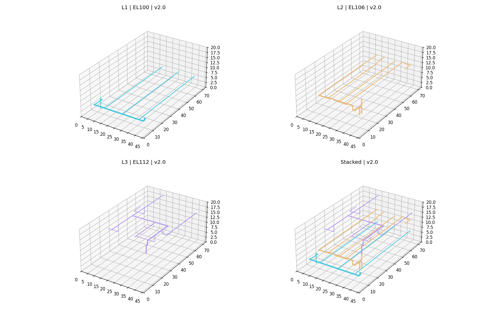
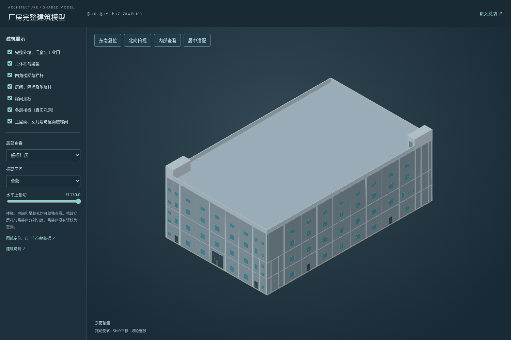
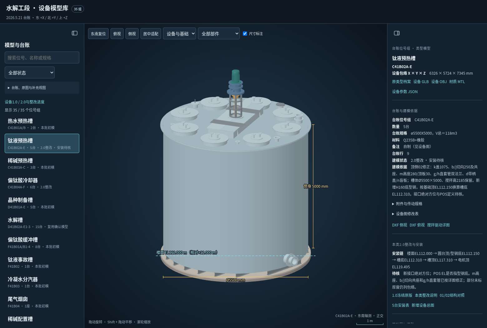

# 水解工段三维项目

桥架、厂房外观、设备和总装分别维护、分别浏览、分别下载。总装继续引用各模块原文件，东 +X、北 +Y、上 +Z，EL100 / 106 / 112；分包不改变模型、结构或安装位置。

| 模块 | GitHub目录与说明 | 单独下载 | 主要内容 |
|---|---|---|---|
| 桥架工程 | [查看桥架](水解桥架工程/) | [桥架ZIP](https://github.com/baetlack/Codex_3D_Model/archive/refs/heads/module-bridge.zip) | 三层桥架、连接件库、GLB/OBJ、1.0与2.0 |
| 厂房外观 | [查看外观](厂房外观模型/) | [外观ZIP](https://github.com/baetlack/Codex_3D_Model/archive/refs/heads/module-building.zip) | 完整建筑、楼梯、房间、开孔楼板、尺寸测量 |
| 设备模型库 | [查看设备](水解设备模型库/) | [设备ZIP](https://github.com/baetlack/Codex_3D_Model/archive/refs/heads/module-equipment.zip) | 35组99项台账、类型模型、基础、图纸、1.0与当前2.0 |
| 水解总装 | [查看总装](水解总装工程/) | [总装ZIP](https://github.com/baetlack/Codex_3D_Model/archive/refs/heads/module-assembly.zip) | 三模块组合、就位表、空间核对；含完整依赖 |

[全部发布版本及固定版本下载](https://github.com/baetlack/Codex_3D_Model/releases) · 每个ZIP根目录含 `下载包清单.json`，逐文件记录SHA256。

GitHub页面可以分别查看目录、说明、参数和预览图；交互式3D需要下载后在浏览器打开。仓库及发布包沿用私有权限，下载时需登录有访问权的GitHub账号。

下载对应ZIP，**完整解压后双击根目录 `index.html`**，再选择本包模型。不要只取出其中的HTML或JS。推荐使用桌面版Chrome或Edge；如浏览器限制本地文件，在解压目录运行 `python -m http.server 8000`，访问 `http://localhost:8000/`。

设备包已附带原路径中的基础、支架及相关图纸依赖，不必另下载桥架包。总装包包含三个模块。跨模块导航会提示下载对应模块；不需要组合时，只下载所需的独立包即可。

<details><summary>桥架预览</summary>



</details>
<details><summary>厂房外观预览</summary>



</details>
<details><summary>设备预览 · 钛液预热槽当前修订</summary>



</details>

桥架当前2.0，1.0冻结保留；设备当前逐类整改，C41B02-02外形及精度已确认，C41B04为2.0-C41B04-01，两类共11项整改、其余88项保持。设备1.0、C41B02上一工作版01和旧Release均保留。[版本与整改进度](水解设备模型库/版本/index.html) · [桥架版本说明](水解桥架工程/README.md) · [备用设备模型（已弃用）](备用设备模型/README.md)。

完整维护与重建请克隆完整仓库，按各模块README及AGENTS操作。独立ZIP面向浏览和模型下载，发布清单记录源提交与每个文件的SHA256。分包范围在 [modules.json](modules.json)；发布工具只读取源文件，不移动或改写它们。

```sh
python tools/package_modules.py --output /tmp/hydrolysis-packages
python tools/test_module_packages.py --output /tmp/hydrolysis-packages --browser
```

后续每次发布使用新的 `modules-*` 标签，运行上述打包与校验，再运行 `python tools/publish_module_branches.py --output /tmp/hydrolysis-packages --version modules-YYYY-MM-DD` 生成模块分支与版本标签，检查后用Git推送这八个引用。Release中列出四个标签的原生ZIP下载链接。各模块发布到 `module-*` 分支，GitHub原生生成独立ZIP；固定版本使用 `modules-日期-模块` 标签，旧标签及Release不覆盖。浏览检查需要安装Playwright/Chromium。
