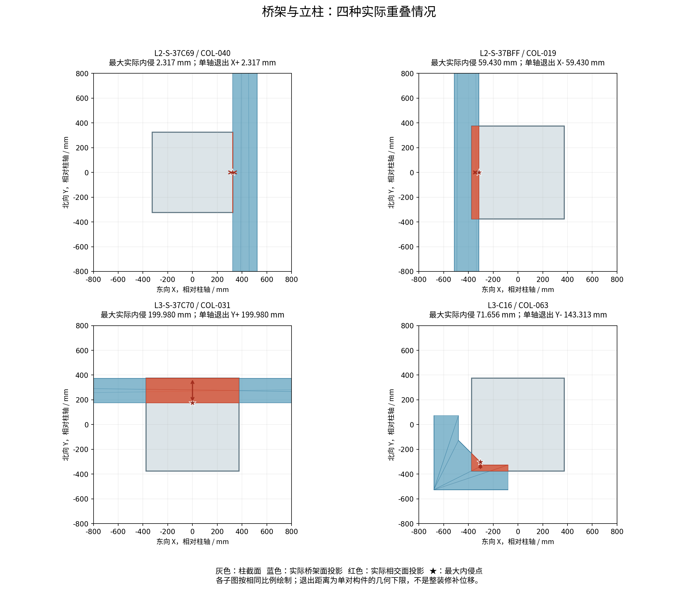

# 桥架与立柱穿入程度完整统计

当前模型：69组实际穿入、18组正常接触；涉及35件桥架、38根柱。按构件—柱配对计数，同一构件或同一柱可能出现多次。

核对范围为112件桥架，以及{'structure': 88, 'room_column': 8, 'stair_column': 24}。原主体柱报告已逐对核验一致；新增附属柱另算，不能将两份报告的数量相加。

## 统计口径

实际桥架面进入柱体后，距最近X/Y柱侧面的最大距离；不是包围盒跨度，也不是旧报告三角面采样点深度。
仅对这一对模型，沿X或Y四个正负方向中，刚好不再穿柱的最小平移距离（允许表面接触）。
东+X、北+Y；数值只用于比较几何重叠程度，不是可直接应用到整条桥架的整改位移。
为本次统计自定义的比较档位，不是施工规范的合格/不合格阈值。

## 全部69组的深度分档

| 最大实际内侵深度 | L1 | L2 | L3 | 合计 |
|---|---:|---:|---:|---:|
| 0.1–10 mm | 2 | 14 | 5 | 21 |
| >10–30 mm | 3 | 4 | 10 | 17 |
| >30–60 mm | 10 | 9 | 8 | 27 |
| >60–100 mm | 0 | 0 | 1 | 1 |
| >100 mm | 0 | 0 | 3 | 3 |

## 单轴移至刚好不穿柱的距离分档（不是整改方案）

| 单对几何退出距离 | 组数 |
|---|---:|
| 0.1–10 mm | 21 |
| >10–30 mm | 16 |
| >30–60 mm | 28 |
| >60–100 mm | 0 |
| >100 mm | 4 |

## 结论与优先核对位置

- 21组在10mm内，38组在30mm内；27组在30–60mm，4组超过60mm。不能把所有几何穿入都直接认定为轻微错位。
- **L3-S-37C70（水平直段）**：COL-031：内侵199.980mm，沿Y+退出199.980mm，被柱覆盖宽度约99.99%；COL-032：内侵199.980mm，沿Y+退出199.980mm，被柱覆盖宽度约99.99%；COL-030：内侵149.980mm，沿Y+退出149.980mm，被柱覆盖宽度约74.99%。
- **L3-C16（水平弯头）**：COL-063：内侵71.656mm，沿Y-退出143.313mm。
- **浅但长的擦入**：L3-S-37C28 / COL-028深度10.976mm，但沿柱竖向交叠2398.577mm。竖向长度不能当成穿入深度。
- **浅但长的擦入**：L3-S-37C24 / COL-064深度10.976mm，但沿柱竖向交叠2400.122mm。竖向长度不能当成穿入深度。
- **截面差值实例**：同一L2-S-37BFF与650柱内侵9.430mm、与750柱内侵59.430mm，恰差50mm；这支持先核对柱截面，不等于可以将柱改小。
- **截面差值实例**：同一L2-S-37C69与650柱内侵2.317mm、与750柱内侵52.317mm，恰差50mm；这支持先核对柱截面，不等于可以将柱改小。
- **截面差值实例**：同一L3-S-37C70与650柱内侵149.980mm、与750柱内侵199.980mm，恰差50mm；这支持先核对柱截面，不等于可以将柱改小。
- 40组发生在750×750柱上，其中27组在30–60mm。750比650柱每侧多50mm，与部分成组差值相符，但不能据此确认错位成因或擅自修改柱截面。
- 同一桥架常连续碰到多根柱，应结合整段走向、接口和柱截面核对，不能把本表平移下限直接逐件套用。
- 最深内侵与退出距离不是同一个量；弯头、三通等角部交叠尤其不能只取旧报告的采样点深度当修补量。

## 所有穿入配对（按深度降序）

| 桥架 | 立柱 | 柱截面mm | 最深内侵mm | 单轴退出距离mm | 方向 |
|---|---|---|---:|---:|---|
| L3-S-37C70 | COL-031 | 750×750 | 199.980 | 199.980 | Y+ |
| L3-S-37C70 | COL-032 | 750×750 | 199.980 | 199.980 | Y+ |
| L3-S-37C70 | COL-030 | 650×650 | 149.980 | 149.980 | Y+ |
| L3-C16 | COL-063 | 750×750 | 71.656 | 143.313 | Y- |
| L2-S-37BFF | COL-019 | 750×750 | 59.430 | 59.430 | X- |
| L2-S-37BFF | COL-028 | 750×750 | 59.430 | 59.430 | X- |
| L2-S-37BFF | COL-055 | 750×750 | 59.430 | 59.430 | X- |
| L2-S-37BFF | COL-064 | 750×750 | 59.430 | 59.430 | X- |
| L2-S-37BFF | COL-073 | 750×750 | 59.430 | 59.430 | X- |
| L2-S-37BFF | COL-083 | 750×750 | 59.430 | 59.430 | X- |
| L1-C08 | COL-018 | 750×750 | 55.208 | 55.208 | X- |
| L2-S-37C69 | COL-022 | 750×750 | 52.317 | 52.317 | X+ |
| L2-S-37C69 | COL-031 | 750×750 | 52.317 | 52.317 | X+ |
| L2-S-37C69 | COL-049 | 750×750 | 52.317 | 52.317 | X+ |
| L3-C03 | COL-028 | 750×750 | 50.019 | 50.019 | Y- |
| L3-S-37C27 | COL-027 | 750×750 | 50.019 | 50.019 | Y- |
| L3-S-37C27 | COL-028 | 750×750 | 50.019 | 50.019 | Y- |
| L1-S-37BFC | COL-019 | 750×750 | 49.638 | 49.638 | X+ |
| L1-S-37BFC | COL-028 | 750×750 | 49.638 | 49.638 | X+ |
| L1-S-37BFC | COL-055 | 750×750 | 49.638 | 49.638 | X+ |
| L1-S-37BFC | COL-064 | 750×750 | 49.638 | 49.638 | X+ |
| L1-S-37BFC | COL-073 | 750×750 | 49.638 | 49.638 | X+ |
| L1-S-37BFC | COL-083 | 750×750 | 49.638 | 49.638 | X+ |
| L1-S-37C46 | COL-023 | 750×750 | 49.638 | 49.638 | X+ |
| L1-S-37C46 | COL-032 | 750×750 | 49.638 | 49.638 | X+ |
| L1-S-37C46 | COL-050 | 750×750 | 49.638 | 49.638 | X+ |
| L3-C17 | COL-064 | 750×750 | 48.422 | 48.422 | Y- |
| L3-S-37C21 | COL-063 | 750×750 | 48.422 | 48.422 | Y- |
| L3-S-37C21 | COL-064 | 750×750 | 48.422 | 48.422 | Y- |
| L3-S-37C1A | COL-049 | 750×750 | 47.030 | 47.030 | Y+ |
| L3-S-37C1A | COL-050 | 750×750 | 47.030 | 47.030 | Y+ |
| L1-C05 | STAIR-SE-TZ-4 | 300×400 | 26.118 | 26.118 | X+ |
| L1-C06 | STAIR-SE-TZ-4 | 300×400 | 26.118 | 26.118 | X+ |
| L1-S-37C48 | STAIR-SE-TZ-4 | 300×400 | 26.118 | 26.118 | X+ |
| L2-C05 | COL-013 | 650×650 | 15.922 | 31.844 | X+ |
| L2-C02 | COL-011 | 650×650 | 14.769 | 29.538 | X+ |
| L2-C08 | COL-012 | 650×650 | 14.769 | 29.538 | X+ |
| L3-C02 | COL-028 | 750×750 | 10.976 | 10.976 | X+ |
| L3-C15 | COL-064 | 750×750 | 10.976 | 10.976 | X+ |
| L3-S-37BE5 | COL-019 | 750×750 | 10.976 | 10.976 | X+ |
| L3-S-37BE6 | COL-028 | 750×750 | 10.976 | 10.976 | X+ |
| L3-S-37C1F | COL-055 | 750×750 | 10.976 | 10.976 | X+ |
| L3-S-37C20 | COL-064 | 750×750 | 10.976 | 10.976 | X+ |
| L3-S-37C20 | COL-073 | 750×750 | 10.976 | 10.976 | X+ |
| L3-S-37C20 | COL-083 | 750×750 | 10.976 | 10.976 | X+ |
| L3-S-37C24 | COL-064 | 750×750 | 10.976 | 10.976 | X+ |
| L3-S-37C28 | COL-028 | 750×750 | 10.976 | 10.976 | X+ |
| L2-C11 | COL-014 | 650×650 | 10.491 | 20.981 | Y- |
| L2-C01 | COL-010 | 650×650 | 9.430 | 9.430 | X- |
| L2-S-37BFF | COL-010 | 650×650 | 9.430 | 9.430 | X- |
| L2-S-37BFF | COL-037 | 650×650 | 9.430 | 9.430 | X- |
| L2-S-37BFF | COL-046 | 650×650 | 9.430 | 9.430 | X- |
| L2-S-37BFF | COL-092 | 650×650 | 9.430 | 9.430 | X- |
| L1-C01 | COL-009 | 650×650 | 5.208 | 5.208 | X- |
| L1-S-37E70 | COL-009 | 650×650 | 5.208 | 5.208 | X- |
| L3-C09 | COL-043 | 650×650 | 4.332 | 4.332 | X- |
| L3-S-37EF1 | COL-052 | 650×650 | 4.332 | 4.332 | X- |
| L3-S-37EF1 | COL-061 | 650×650 | 4.332 | 4.332 | X- |
| L3-S-37EF1 | COL-070 | 650×650 | 4.332 | 4.332 | X- |
| L3-S-37EF1 | COL-079 | 650×650 | 4.332 | 4.332 | X- |
| L2-S-37C69 | COL-013 | 650×650 | 2.317 | 2.317 | X+ |
| L2-S-37C69 | COL-040 | 650×650 | 2.317 | 2.317 | X+ |
| L2-S-37C69 | COL-058 | 650×650 | 2.317 | 2.317 | X+ |
| L2-S-37C69 | COL-067 | 650×650 | 2.317 | 2.317 | X+ |
| L2-S-37C69 | COL-076 | 650×650 | 2.317 | 2.317 | X+ |
| L2-S-37C69 | COL-086 | 650×650 | 2.317 | 2.317 | X+ |
| L2-C19 | COL-095 | 650×650 | 2.042 | 2.042 | Y- |
| L2-C20 | COL-096 | 650×650 | 2.042 | 2.042 | Y- |
| L2-S-37ED2 | COL-096 | 650×650 | 2.042 | 2.042 | Y- |

## 按桥架构件归并

| 桥架 | 类型 | 穿入配对数 | 涉及立柱 | 深度mm |
|---|---|---:|---|---|
| L1-C01 | 水平弯头 | 1 | COL-009 | 5.208 |
| L1-C05 | 水平弯头 | 1 | STAIR-SE-TZ-4 | 26.118 |
| L1-C06 | 垂直下弯 | 1 | STAIR-SE-TZ-4 | 26.118 |
| L1-C08 | 水平弯头 | 1 | COL-018 | 55.208 |
| L1-S-37BFC | 水平直段 | 6 | COL-019, COL-028, COL-055, COL-064, COL-073, COL-083 | 49.638 |
| L1-S-37C46 | 水平直段 | 3 | COL-023, COL-032, COL-050 | 49.638 |
| L1-S-37C48 | 水平直段 | 1 | STAIR-SE-TZ-4 | 26.118 |
| L1-S-37E70 | 水平直段 | 1 | COL-009 | 5.208 |
| L2-C01 | 水平弯头 | 1 | COL-010 | 9.430 |
| L2-C02 | 水平三通 | 1 | COL-011 | 14.769 |
| L2-C05 | 水平三通 | 1 | COL-013 | 15.922 |
| L2-C08 | 水平三通 | 1 | COL-012 | 14.769 |
| L2-C11 | 水平弯头 | 1 | COL-014 | 10.491 |
| L2-C19 | 水平弯头 | 1 | COL-095 | 2.042 |
| L2-C20 | 水平弯头 | 1 | COL-096 | 2.042 |
| L2-S-37BFF | 水平直段 | 10 | COL-010, COL-019, COL-028, COL-037, COL-046, COL-055, COL-064, COL-073, COL-083, COL-092 | 9.430, 59.430 |
| L2-S-37C69 | 水平直段 | 9 | COL-013, COL-022, COL-031, COL-040, COL-049, COL-058, COL-067, COL-076, COL-086 | 2.317, 52.317 |
| L2-S-37ED2 | 水平直段 | 1 | COL-096 | 2.042 |
| L3-C02 | 垂直三通 | 1 | COL-028 | 10.976 |
| L3-C03 | 垂直下弯 | 1 | COL-028 | 50.019 |
| L3-C09 | 水平弯头 | 1 | COL-043 | 4.332 |
| L3-C15 | 垂直三通 | 1 | COL-064 | 10.976 |
| L3-C16 | 水平弯头 | 1 | COL-063 | 71.656 |
| L3-C17 | 垂直下弯 | 1 | COL-064 | 48.422 |
| L3-S-37BE5 | 水平直段 | 1 | COL-019 | 10.976 |
| L3-S-37BE6 | 水平直段 | 1 | COL-028 | 10.976 |
| L3-S-37C1A | 水平直段 | 2 | COL-049, COL-050 | 47.030 |
| L3-S-37C1F | 水平直段 | 1 | COL-055 | 10.976 |
| L3-S-37C20 | 水平直段 | 3 | COL-064, COL-073, COL-083 | 10.976 |
| L3-S-37C21 | 水平直段 | 2 | COL-063, COL-064 | 48.422 |
| L3-S-37C24 | 竖向直段 | 1 | COL-064 | 10.976 |
| L3-S-37C27 | 水平直段 | 2 | COL-027, COL-028 | 50.019 |
| L3-S-37C28 | 竖向直段 | 1 | COL-028 | 10.976 |
| L3-S-37C70 | 水平直段 | 3 | COL-030, COL-031, COL-032 | 149.980, 199.980 |
| L3-S-37EF1 | 水平直段 | 4 | COL-052, COL-061, COL-070, COL-079 | 4.332 |

## 正常表面接触（不计入穿入）

| 桥架 | 立柱 |
|---|---|
| L2-S-37EC6 | COL-011 |
| L2-S-37EC6 | COL-020 |
| L2-S-37EC6 | COL-029 |
| L2-S-37EC6 | COL-038 |
| L2-S-37EC6 | COL-047 |
| L2-S-37EC6 | COL-056 |
| L2-S-37EC6 | COL-065 |
| L2-S-37EC6 | COL-074 |
| L2-S-37EC1 | COL-012 |
| L2-S-37EB9 | COL-021 |
| L2-S-37EB9 | COL-030 |
| L2-S-37EB9 | COL-039 |
| L2-S-37EB9 | COL-048 |
| L2-S-37EB9 | COL-057 |
| L2-S-37EB9 | COL-066 |
| L2-S-37EB9 | COL-075 |
| L2-S-37EB9 | COL-085 |
| L2-S-37EB9 | COL-094 |

## 仅包围盒候选，未发现实际交叠

| 桥架 | 立柱 |
|---|---|
| L1-C02 | COL-010 |
| L1-C03 | COL-012 |
| L1-C04 | COL-014 |

## 验证与边界

最大深度已用独立线性规划复核69组；每组最小单轴平移均重新计算确认退出后不再穿入（0.1mm容差）。
- 反映当前模型几何，不单凭穿入数值认定成因或施工冲突。
- 750/650柱截面取自5.970–9.900m柱平面并沿用到23m；上部柱截面仍需原结构图逐段复核。
- 未调整任何桥架、建筑或设备模型，未将孤立配对的平移下限作为整装方案。

[CSV全量数据（含正常接触与包围盒排除项）](桥架立柱穿入深度统计.csv) · [JSON几何数据、坐标与源文件SHA256](桥架立柱穿入深度统计.json)
